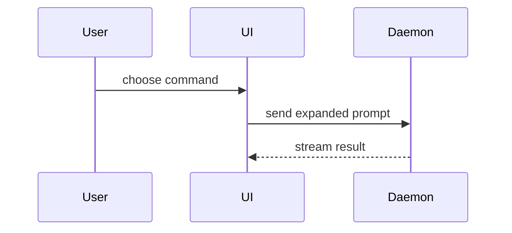

Use this template for writing the PR body:

```markdown
## Summary

<diagram, diff-sketch, or tree>

## Evidence

### Execution evidence

- **Before:** <exact test/command and actual failing output>
  **After:** <same test/command and actual passing output>

### Visual evidence

<required for visual changes when a headless browser is available; repeat for each viewport/flow>


## Merge Danger

**Door:** <one-way or two-way>

<optional: description>

**Blast Radius:** <one-word description>

<optional: potential ramifications of merge>
```

## Sections

Skip all preambles and keep prose brief. Use the user's domain language from `GLOSSARY.md`.

### Summary

Pick the smallest view that makes the key point clear.

- Show logic or an algorithm as pseudocode:

```text
on(save)
  if content is unchanged
    return cached result
  write new content
  return fresh result
```

- Show runtime control flow as a call tree:

```text
submitForm
  createSession
    persistPrompt
    launchAgent
  navigateToSession
```

- Show UI structure as a component tree, including state and module boundaries that matter:

```text
<SessionPage> (apps/example/src/routes/session.tsx)
  useSessionEvents()
  <SessionToolbar>
    <RunSkillButton> (packages/ui)
```

- Show file responsibility or a broad refactor as a shallow file tree:

```text
src/
├── commands/       # parses user actions
├── sessions/       # owns session state
└── transport/      # sends API requests
```

- Show component interaction, control flow, or data flow with Mermaid:



- Use `diff` when the point is what changes and the surrounding shape already exists. Match the diff shape to the topic.

For a component change:

```diff
 <SessionPage>
   useSessionEvents()
   <SessionToolbar>
+    <RunSkillButton />
   <SessionTimeline>
+    <SkillResultCard />
```

For a file-layout change:

```diff
 src/
 ├── commands/
+│   └── show-me.ts       # expands the slash command
 ├── sessions/
-└── transport.ts
+└── transport/
+    ├── client.ts
+    └── stream.ts
```

For a call-tree or call-stack change:

```diff
 submitForm
   createSession
     persistPrompt
+    expandSkillMention
     launchAgent
-  navigateToSession
+  navigateToSession
+    subscribeToEvents
```

For a state or control-flow change:

```diff
 on(save)
-  write content
+  if content is unchanged
+    return cached result
+  write new content
+  invalidate cache
```

- Show the whole block when most of it is new, when omitted context would hide ownership or order, or when the user needs a copyable target shape:

```ts
function expandSkill(command: string): string {
  const skillName = command.slice(1);
  return `use the ${skillName} skill`;
}
```

#### Guidance

Place each visual next to the short text it supports. Keep only the calls, files, props, states, and boundaries needed to answer the user's current question or the options to resolve the current discussion point.

You may use one of these, you may use several, it is unlikely you will use all of them. Use your judgement and don't overwhelm the user.

### Evidence

Always include **Execution evidence**: the exact test or command, its actual failing-before output and its actual passing-after output. Keep this separate from **Visual evidence**.

For changes to rendered UI, HTML, CSS, templates or visual layout, **Visual evidence** is also required when a headless browser is available: embed `` and `` using `.png` screenshots, or `.gif` recordings for interactive or animated flows. Pair captures at the same viewport and state: `1440×900` desktop, plus `390×844` mobile when responsive layout is affected; label each pair with its viewport and flow. If a headless browser is unavailable, state that limitation in Evidence.

#### Recover a missing Before capture

Use the implementation or diagnosis session's `mktemp` capture paths. If Before is missing (including during a Spec review), capture the Base branch commit in a temporary detached worktree, using the same viewport and state as After. Replace `main` below with the PR's Base branch, build and serve that checkout with the project's commands, save each Before capture with `mktemp /tmp/before-desktop.XXXXXX.png` (or `.gif`), then stop the server and remove the worktree:

```sh
(
  set -eu
  before_root=$(mktemp -d /tmp/pr-before.XXXXXX)
  trap 'git worktree remove --force "$before_root/worktree"; rmdir "$before_root"' EXIT
  git worktree add --detach "$before_root/worktree" main
  # Build and serve "$before_root/worktree"; save Before with mktemp /tmp/before-desktop.XXXXXX.png at After's viewport and state.
  # Stop that server before this subshell exits and removes the worktree.
)
```

#### Publish the captures

Host PR-evidence media in a **secret git-pushed Gist**, keeping repository branches free of PR-evidence media files. Use an authenticated `gh` account with Gist access and a Git author configured. Secret Gists are unlisted but readable by anyone with the URL, so publish only captures suitable for that audience, with secrets redacted.

`gh gist create` sends text through the API; create a placeholder text file, then push the binary captures with Git. Export `BEFORE_DESKTOP` and `AFTER_DESKTOP` as the exact `mktemp` paths from this session, and `BEFORE_MOBILE` and `AFTER_MOBILE` when those pairs exist. The recipe copies a path only when it is a regular file owned by this user, and refuses a symlink instead of publishing the link's target:

```sh
(
  set -eu
  evidence_root=$(mktemp -d /tmp/pr-evidence.XXXXXX)
  trap 'rm -rf "$evidence_root"' EXIT
  printf '%s\n' 'Before and After PR evidence' > "$evidence_root/README.md"
  # gh gist create defaults to secret visibility.
  gist_url=$(gh gist create --desc "PR visual evidence" "$evidence_root/README.md")
  gist_id=${gist_url##*/}
  git -c credential.helper= -c 'credential.helper=!gh auth git-credential' \
    clone "https://gist.github.com/$gist_id.git" "$evidence_root/gist"
  copy_regular() {
    src=$1
    if [ -L "$src" ] || [ ! -f "$src" ] || [ ! -O "$src" ]; then
      printf 'refusing capture that is not a regular file owned by this user: %s\n' "$src" >&2
      exit 1
    fi
    filename=${src##*/}
    case "$filename" in
      *[!A-Za-z0-9._-]* | '' | .*)
        printf 'refusing capture filename: %s\n' "$filename" >&2
        exit 1
        ;;
    esac
    case "$filename" in
      *.png | *.gif) ;;
      *)
        printf 'refusing capture filename: %s\n' "$filename" >&2
        exit 1
        ;;
    esac
    dest=$evidence_root/gist/$filename
    cp -P -- "$src" "$dest"
    if [ -L "$dest" ] || [ ! -f "$dest" ]; then
      rm -f -- "$dest"
      printf 'refusing capture that is not a regular file owned by this user: %s\n' "$src" >&2
      exit 1
    fi
    git -C "$evidence_root/gist" add -- "$filename"
  }
  copy_regular "${BEFORE_DESKTOP:?}"
  copy_regular "${AFTER_DESKTOP:?}"
  if [ -n "${BEFORE_MOBILE:-}" ]; then
    copy_regular "$BEFORE_MOBILE"
  fi
  if [ -n "${AFTER_MOBILE:-}" ]; then
    copy_regular "$AFTER_MOBILE"
  fi
  git -C "$evidence_root/gist" commit -m "Add Before and After captures"
  git -c credential.helper= -c 'credential.helper=!gh auth git-credential' \
    -C "$evidence_root/gist" push origin HEAD
  gist_owner=$(gh api "gists/$gist_id" --jq '.owner.login')
  gist_sha=$(git -C "$evidence_root/gist" rev-parse HEAD)
  for capture in "$evidence_root/gist/"*.png "$evidence_root/gist/"*.gif; do
    [ -f "$capture" ] && [ ! -L "$capture" ] || continue
    filename=${capture##*/}
    printf 'https://gist.githubusercontent.com/%s/%s/raw/%s/%s\n' \
      "$gist_owner" "$gist_id" "$gist_sha" "$filename"
  done
)
```

Embed the printed commit-pinned URLs in the Before and After image slots. The temporary clone is removed on exit; retain the Gist so the PR's evidence remains available.

### Merge Danger

Describe whether it's a one-way or two-way door. You can walk back through two-way doors, but not one-way doors. A PR that is cheap to roll back is lower risk. Changes that involve destructive actions or hard-to-reverse decisions are one-way doors.

The blast radius is the potential impact or scope of the changes introduced by this PR. Consider all possibilities. Examples are layout shift, breakages for consumers, mobile responsiveness, etc.
